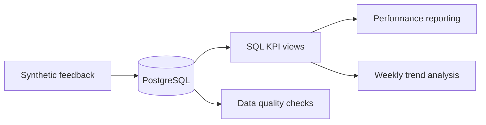

# STANKIN Feedback Intelligence

**SQL-first analytics portfolio project · PostgreSQL · Business Analysis**

> Independent portfolio demonstration, **not an official STANKIN service**. Data is entirely synthetic.

## Business challenge
How can a university identify recurring feedback problems, monitor response delays and compare department performance?

## Skills demonstrated
- PostgreSQL: relational schema, foreign keys, CHECK constraints and partial indexes.
- SQL: aggregations, CTEs, window functions (`LAG`), percentiles and KPI views.
- Analytics: response SLA, resolution rate, CSAT, backlog aging and weekly growth.
- Business analysis: KPI contracts, stakeholders, acceptance criteria and limitations.

## Run locally
Requires PostgreSQL 15+ and `psql`. Create an empty database:
```bash
createdb feedback_analytics
for file in sql/00_demo_schema.sql sql/02_seed.sql sql/03_analytics.sql sql/04_trends.sql sql/05_quality.sql; do psql -v ON_ERROR_STOP=1 -d feedback_analytics -f "$file"; done
```
Use synthetic data only. Do not commit credentials.

## Project map
| File | Responsibility |
|---|---|
| [00_demo_schema.sql](sql/00_demo_schema.sql) | Standalone analytics database model and indexes |
| [02_seed.sql](sql/02_seed.sql) | 500 synthetic submissions |
| [03_analytics.sql](sql/03_analytics.sql) | KPI views and percentile metrics |
| [04_trends.sql](sql/04_trends.sql) | Window functions and emerging issues |
| [05_quality.sql](sql/05_quality.sql) | Data integrity checks |
| [Case study](docs/case-study.md) | Business requirements and metric definitions |

## Data flow


The existing [01_schema.sql](sql/01_schema.sql) is a separate legacy Telegram reference schema and is not required for this standalone demo.\n\n## Current status
**SQL analytics prototype.** A production Telegram bot, automated moderation, deployed dashboard and end-to-end tests are **not yet implemented**. The project is intended to be reproducible and extended in later iterations.

Maintainer: [NickolayBoss](https://github.com/NickolayBoss).
